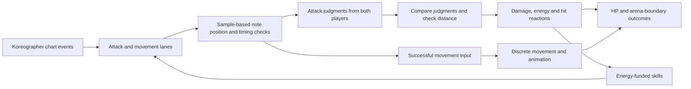

# Beat! & Fight! — Rhythm × Fighting

**A local two-player rhythm-fighting prototype where timing, spacing, and resource decisions share the same battle.**

Beat! & Fight! explores a gameplay question: **what happens when moving and attacking in a fighting game become actions earned through rhythm input?** Players read horizontal notes, choose when to advance or retreat, and compete on timing accuracy to deal damage, build energy, and push their opponent toward the arena edge.

Developed as a Final Year Project (FYP) in Unity and C#, with Koreographer supporting the music-event workflow.

[中文介绍](#中文介绍) · [Play the demo](#play-the-demo) · [Controls](#controls) · [Implementation and source guide](#implementation-and-source-guide)

## Design inspiration

The horizontal note presentation draws inspiration from **Muse Dash** and **Taiko no Tatsujin**, while the combat concept takes inspiration from **The King of Fighters** and **Street Fighter**.

The project brings these influences together through a simplified set of combat decisions: approach, retreat, attack, manage energy, and use skills. Music provides the timing opportunities for movement and attacks; distance and the opponent's timing result determine what those opportunities achieve.

These titles are design references. The prototype implements its own simplified interaction rules rather than reproducing their full combat systems.

## Core gameplay

### Horizontal notes, two distinct purposes

Each player has an **attack lane** and a **movement lane**, with mirrored horizontal note motion for the two sides.

- **Movement notes:** a successful timing judgment permits one forward or backward movement action. The player chooses the direction, so a note becomes an opportunity to control distance.
- **Attack notes:** inputs receive **Perfect**, **Good**, or **Miss** judgments. The combat controller collects both players' results and resolves the exchange.
- **Spacing:** normal attack damage is resolved only when the fighters are within the configured attack distance. A successful rhythm input alone does not guarantee damage.

This makes reading the chart part of a duel: players must consider both the next note and their position relative to the opponent.

### Timing becomes combat advantage

In the current source, normal attack exchanges use a distance threshold of **1.5 world units**. Within that range, the judgment comparison determines the outcome:

| Timing comparison | Damage outcome |
| --- | --- |
| Perfect vs. Perfect | Neither player takes normal attack damage |
| Perfect vs. Good | The Good player takes 2 damage |
| Perfect vs. Miss | The Miss player takes 3 damage |
| Good vs. Good | Neither player takes normal attack damage |
| Good vs. Miss | The Miss player takes 2 damage |
| Miss vs. Miss | Neither player deals damage |

The rules are symmetric between players. Successful judgments within attack range also build energy: **Perfect grants 2 points; Good grants 1 point**. Damage outcomes trigger corresponding hit reactions and knockback.

See the [attack-resolution logic](https://github.com/oilmanCN/FYP_BeatAndFight/blob/60efe4c691c9adf6ece8bdb394e47d56d6a77281/fyp_finalVer/Assets/Rhythm%20Fighting%20Game/Scripts/AttackControllerServer.cs#L95).

### Energy creates additional choices

Energy is stored in up to **three stocks**, with a default requirement of **10 points per stock**. Players can spend it on three skill effects:

| Cost | Effect in the current source |
| --- | --- |
| 1 stock | Temporarily changes the opponent's attack and movement note speeds in opposite directions for 5 seconds |
| 2 stocks | Restores 10 HP, deals 2 damage, and temporarily disables the opponent's judgment and skill objects for 3 seconds |
| 3 stocks | Applies a strong knockback to the opponent |

The first skill changes note travel speed, not the music's playback tempo. Skills use separate keys and require sufficient energy.

See [energy storage](https://github.com/oilmanCN/FYP_BeatAndFight/blob/60efe4c691c9adf6ece8bdb394e47d56d6a77281/fyp_finalVer/Assets/Rhythm%20Fighting%20Game/Scripts/PowerController1P.cs) and [skill effects](https://github.com/oilmanCN/FYP_BeatAndFight/blob/60efe4c691c9adf6ece8bdb394e47d56d6a77281/fyp_finalVer/Assets/Rhythm%20Fighting%20Game/Scripts/SkillControllerServer.cs).

### More than one route to victory

A match can end through:

- **K.O.:** reduce the opponent's HP to zero.
- **Ring-out:** force the opponent beyond the arena boundary.
- **Time-out:** compare remaining HP when the round timer expires; equal HP produces a draw.

The project also includes a song-selection flow with four song entries and a random-selection option, a training room, a six-page tutorial, and settings for volume, brightness, resolution, and a timing-offset value.

## Play the demo

The repository includes a prebuilt **Windows demo** in [FYP_demo](FYP_demo).

1. Download the repository using **Code → Download ZIP**, then extract it.
2. Open the extracted `FYP_demo` folder.
3. Run `Beat!&Fight!.exe`.
4. Start with the training room and in-game tutorial, then try a two-player match.

Keep the **entire demo folder** together, including `Beat!&Fight!_Data`, `UnityPlayer.dll`, and the runtime files. Downloading only the executable is insufficient.

The demo uses two players on the same keyboard. Files named `*Server` are local gameplay coordinators; they do not indicate online multiplayer.

### Controls

The following bindings are taken from the repository's `RhythmGame` scene:

| Action | Player 1 | Player 2 |
| --- | --- | --- |
| Move toward opponent, on a movement note | D | ← |
| Move away from opponent, on a movement note | A | → |
| Hit an attack note | V | K |
| Skill 1 / 2 / 3 | Q / W / E | U / I / O |
| Open / close the in-game menu | Esc | Esc |

The Esc menu is an overlay that mutes audio; the current script does **not** implement a full gameplay pause. Use the training room to learn the controls before starting a match.

## Implementation and source guide

The engineering work lies in connecting **music time, note judgments, and combat state** into one interaction loop.



### 1. A shared sample-time reference

Note positions are calculated from the difference between the current music sample and the note's scheduled sample. The two players use opposite signs for horizontal movement. This ties visual progress to the music timeline instead of relying only on accumulated per-frame movement.

The note scripts also compare sample positions for Perfect / Good / Miss. At 44.1 kHz, their current constants correspond to approximately **±30 ms for Perfect** and **±90 ms for Good**, with Perfect checked first. These constants currently assume 44.1 kHz; they are not a fully sample-rate-independent calibration system.

### 2. Separate rhythm input from combat resolution

Attack lanes publish judgments through the `NoteJudged` event. `AttackControllerServer` collects the results for both players, checks distance, then applies damage, energy gains, animation triggers, and knockback.

Movement lanes take a different path: a successful timing check calls `AvatarMove` with the chosen direction. Movement and knockback use coroutines, alongside proximity checks and collision callbacks.

### 3. Manage multiple note streams and their lifetimes

The rhythm layer uses event lists for scheduled chart data, queues for active notes, and stack-based pools for reusing note objects. Attack and movement tracks are selected independently for each song. This structure supports the two players' parallel rhythm streams and avoids creating a fresh object for every note once reusable objects are available.

Parts of this rhythm framework build on Koreographer's demo code. The project's extensions include the mirrored horizontal presentation, separate attack/movement tracks, two-player judgments, and their integration with combat.

### Source entry points

| Area | Code to explore |
| --- | --- |
| Song and attack/movement track selection | [SelectedSongController](https://github.com/oilmanCN/FYP_BeatAndFight/blob/60efe4c691c9adf6ece8bdb394e47d56d6a77281/fyp_finalVer/Assets/Rhythm%20Fighting%20Game/Scripts/SelectedSongController.cs#L39) |
| Music timing, event routing, and note pooling | [RhythmGameController1P](https://github.com/oilmanCN/FYP_BeatAndFight/blob/60efe4c691c9adf6ece8bdb394e47d56d6a77281/fyp_finalVer/Assets/Rhythm%20Fighting%20Game/Scripts/RhythmGameController1P.cs), [PaceController1P](https://github.com/oilmanCN/FYP_BeatAndFight/blob/60efe4c691c9adf6ece8bdb394e47d56d6a77281/fyp_finalVer/Assets/Rhythm%20Fighting%20Game/Scripts/PaceController1P.cs) |
| Mirrored horizontal motion and timing checks | [NoteObject1P](https://github.com/oilmanCN/FYP_BeatAndFight/blob/60efe4c691c9adf6ece8bdb394e47d56d6a77281/fyp_finalVer/Assets/Rhythm%20Fighting%20Game/Scripts/NoteObject1P.cs#L84), [NoteObject2P](https://github.com/oilmanCN/FYP_BeatAndFight/blob/60efe4c691c9adf6ece8bdb394e47d56d6a77281/fyp_finalVer/Assets/Rhythm%20Fighting%20Game/Scripts/NoteObject2P.cs#L85) |
| Input judgments and movement gating | [LaneController1P](https://github.com/oilmanCN/FYP_BeatAndFight/blob/60efe4c691c9adf6ece8bdb394e47d56d6a77281/fyp_finalVer/Assets/Rhythm%20Fighting%20Game/Scripts/LaneController1P.cs#L212), [PaceLaneController1P](https://github.com/oilmanCN/FYP_BeatAndFight/blob/60efe4c691c9adf6ece8bdb394e47d56d6a77281/fyp_finalVer/Assets/Rhythm%20Fighting%20Game/Scripts/PaceLaneController1P.cs#L228) |
| Two-player attack resolution | [AttackControllerServer](https://github.com/oilmanCN/FYP_BeatAndFight/blob/60efe4c691c9adf6ece8bdb394e47d56d6a77281/fyp_finalVer/Assets/Rhythm%20Fighting%20Game/Scripts/AttackControllerServer.cs#L95) |
| Movement, spacing, and knockback | [P1Movement](https://github.com/oilmanCN/FYP_BeatAndFight/blob/60efe4c691c9adf6ece8bdb394e47d56d6a77281/fyp_finalVer/Assets/Rhythm%20Fighting%20Game/Scripts/P1Movement.cs#L127), [P2Movement](https://github.com/oilmanCN/FYP_BeatAndFight/blob/60efe4c691c9adf6ece8bdb394e47d56d6a77281/fyp_finalVer/Assets/Rhythm%20Fighting%20Game/Scripts/P2Movement.cs#L63) |
| HP feedback, energy, and skills | [HPController1P](https://github.com/oilmanCN/FYP_BeatAndFight/blob/60efe4c691c9adf6ece8bdb394e47d56d6a77281/fyp_finalVer/Assets/Rhythm%20Fighting%20Game/Scripts/HPController1P.cs), [PowerController1P](https://github.com/oilmanCN/FYP_BeatAndFight/blob/60efe4c691c9adf6ece8bdb394e47d56d6a77281/fyp_finalVer/Assets/Rhythm%20Fighting%20Game/Scripts/PowerController1P.cs), [SkillControllerServer](https://github.com/oilmanCN/FYP_BeatAndFight/blob/60efe4c691c9adf6ece8bdb394e47d56d6a77281/fyp_finalVer/Assets/Rhythm%20Fighting%20Game/Scripts/SkillControllerServer.cs) |
| K.O., ring-out, and time-out | [GameOverManager](https://github.com/oilmanCN/FYP_BeatAndFight/blob/60efe4c691c9adf6ece8bdb394e47d56d6a77281/fyp_finalVer/Assets/Rhythm%20Fighting%20Game/Scripts/GameOverManager.cs), [Timer](https://github.com/oilmanCN/FYP_BeatAndFight/blob/60efe4c691c9adf6ece8bdb394e47d56d6a77281/fyp_finalVer/Assets/Rhythm%20Fighting%20Game/Scripts/Timer.cs) |

These source links are pinned to the implementation snapshot at commit `60efe4c`, so the described behavior can be checked against a fixed version.

## Project layout and development environment

```text
FYP_demo/                       Windows build and runtime data
fyp_finalVer/
  Assets/
    Rhythm Fighting Game/
      Scripts/                  Gameplay and UI scripts
      Scenes/                   Start Menu, RhythmGame, TrainingRoom
    Koreographer/               Music-event plugin and demo resources
  Packages/
  ProjectSettings/
```

- **Language:** C#
- **Engine version recorded by the project:** Unity **2021.3.26f1c1**
- **Music-event tooling:** Koreographer
- **Presentation and interaction:** Unity Animator, uGUI, coroutines, and collision callbacks

For source exploration, add `fyp_finalVer` through Unity Hub and use the recorded editor version where possible. Begin with `Assets/Rhythm Fighting Game/Scenes/Start Menu.unity`, since gameplay scenes depend on song-selection and settings state.

The version above comes from [ProjectVersion.txt](fyp_finalVer/ProjectSettings/ProjectVersion.txt), correcting the earlier README's Unity 2022 description. The repository includes a prebuilt demo; a fresh player build from the current source has not been verified for this documentation update.

## Prototype scope and future work

This is a learning and gameplay-exploration prototype. The current implementation demonstrates the rhythm/combat interaction, with room to improve:

- Consolidate duplicated Player 1 / Player 2 controllers into reusable components.
- Pair judgments by chart-event identity rather than keeping only each player's latest result.
- Unify timing windows, sample-rate handling, and timing-offset initialization.
- Improve pause/restart behavior and test overlapping skill effects and repeated scene transitions.

The feature descriptions and numerical examples above are based on the checked-in scripts and scene settings. They are not performance benchmarks or a claim that every runtime path has been tested.

## 中文介绍

**Beat! & Fight! 是一个将横向音游与本地双人格斗结合的毕业设计原型：节奏决定行动时机，距离与判定结果决定交锋收益。**

项目的横向音符设计受到《Muse Dash》《太鼓达人》启发，格斗思路参考《拳皇》《街霸》，尝试把前进、后退、攻击、能量管理与技能使用放进同一套节奏对抗规则中。

### 玩法亮点

- **双侧镜像横向谱面：** 双方分别读取攻击与步伐音符。命中步伐音符后，玩家自主选择向前或向后移动，让走位成为节奏中的决策。
- **判定驱动交锋：** 攻击并非命中音符就直接扣血，而是比较双方的 Perfect / Good / Miss，再结合攻击距离结算伤害、击退和能量。
- **能量与技能：** 成功的近距离攻击判定积累能量，可用于干扰对方音符速度、恢复与短暂限制对方操作，或施加强力击退。
- **多种胜利条件：** 除了耗尽生命值，还可以将对手推出场地；时间结束时则比较剩余生命值。
- **完整体验入口：** 仓库提供 Windows Demo、选曲、训练场、教程和设置界面。

### 技术实现

核心工作是把音乐事件、输入判定、角色动作和战斗状态连接起来：以音频采样位置计算音符位置和判定，通过事件汇总双方攻击结果，再驱动伤害、能量、动画和位移；同时管理双方的攻击／步伐轨道、音符队列与对象复用。

节奏层基于 Koreographer 及其示例代码扩展。项目的重点在于横向双人呈现、攻击与移动的分离，以及节奏结果与格斗规则的整合。上方源码索引提供了对应实现，便于直接核验。

试玩时请完整下载并保留 `FYP_demo` 文件夹，运行 `Beat!&Fight!.exe`。1P 使用 **A / D 移动、V 攻击、Q / W / E 技能**；2P 使用 **← / → 移动、K 攻击、U / I / O 技能**。移动和普通攻击需要配合对应音符时机。

## Credits and use

This is a non-commercial student learning project. Koreographer and the original demo-code portions belong to **Sonic Bloom, LLC**; relevant copyright headers are retained in the source. Third-party music, models, animations, and other assets remain the property of their respective owners.

The design-reference games listed above are credited as inspiration. Inclusion in this repository does not imply authorship of third-party assets or permission to reuse them under a new license.

For attribution corrections or removal requests, please [open an issue](https://github.com/oilmanCN/FYP_BeatAndFight/issues).
